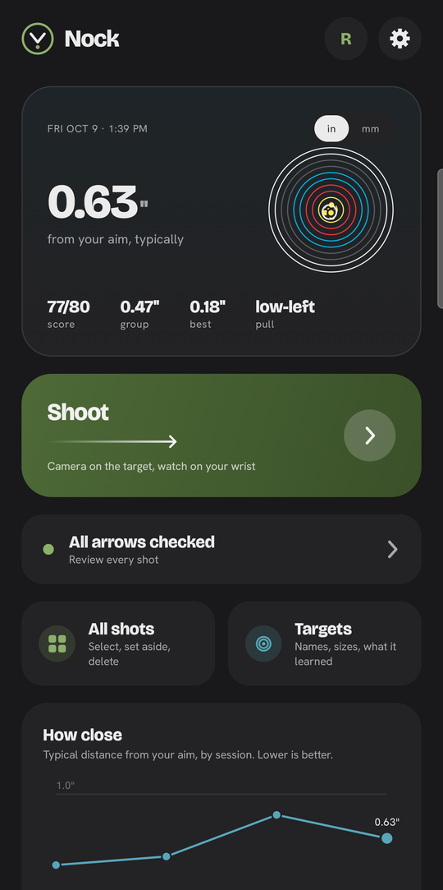
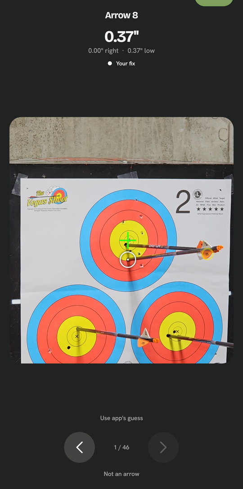

# Nock

An archery practice app for Android and Galaxy Watch. **Point your phone at the target, shoot, and Nock finds every
arrow hit on its own** and sends it to your watch, so you never walk downrange to score.

<p>
  
  
</p>

## What it does

- **Finds targets and hits by camera.** Nock recognizes the targets in view, then spots each new arrow and scores it.
  Any target face can be marked once and recognized after that.
- **Watch form card.** The Galaxy Watch records how you hold, your last moment before release, and your follow-through
  for each shot, compared against your own average.
- **Tracks growth over time**, with a trend chart per person.
- **Several shooters on one phone**, each with their own color and stats. A guest mode lets a friend shoot without
  touching anyone's numbers.

## The hard part: live computer vision on a phone

Looking for targets and arrows in every camera frame drained the battery and heated the phone. Profiling the real app
on a Galaxy S23 Ultra led to three fixes:

- Each frame now reuses one image buffer instead of copying it: **15 ms → 1.3 ms per frame**.
- Image processing uses every CPU core only while it is actively searching, and one core the rest of the time.
- Target features are saved to disk, so the first look after opening is about twice as fast.

Together, these cut CPU use from **173% to 125% of a core**, and finding the targets now takes **1.5–1.8 seconds** from
a cold start.

## Built with

Kotlin and Jetpack Compose (phone), Wear OS (watch), OpenCV for image processing, and Python tools for testing the
detection on recorded sessions.

## Build

Requires JDK 17+ and the Android SDK.

```
./gradlew :phone:assembleDebug
./gradlew :watch:assembleDebug
```
